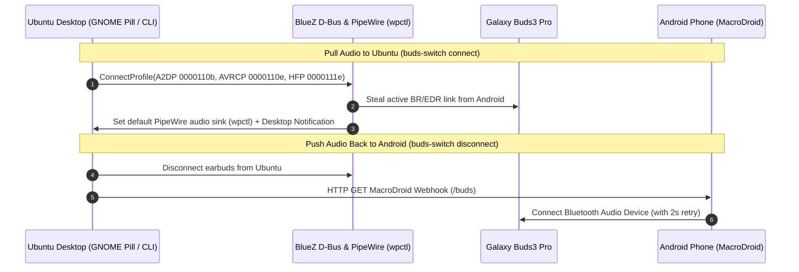

```bash
$ buds-switch toggle
```

<h1 align="center">🎧 Galaxy Buds3 Pro - Ubuntu & Android Seamless Switcher</h1>
<h3 align="center">One-Click GNOME Quick Settings Toggle & Bidirectional Audio Handoff for Linux</h3>

<p align="center">
  <a href="https://github.com/pulkitmundra/galaxy-buds-ubuntu">
    
  </a>
</p>

<p align="center">
  
  
  
  
</p>

<p align="center">
  <a href="https://github.com/pulkitmundra/galaxy-buds-ubuntu/stargazers"></a>&nbsp;
  <a href="https://github.com/pulkitmundra"></a>&nbsp;
  <a href="https://pulkit-mundra-portfolio.vercel.app"></a>
</p>

<p align="center">
  <a href="#why-this-exists">Why This Exists</a> -
  <a href="#architecture">Architecture</a> -
  <a href="#quick-start">Quick Start</a> -
  <a href="#android-setup">Android Setup</a> -
  <a href="#cli-usage">CLI Usage</a> -
  <a href="#author">Author</a>
</p>

---

<a id="why-this-exists"></a>
## ⚡ The Problem & How This Solves It

Samsung Galaxy Buds3 Pro only support *Samsung Seamless Switch* between Samsung Galaxy devices, and advertise **both** Classic Bluetooth (`BR/EDR`) and Bluetooth Low Energy (`LE Audio`) over the same MAC address. On Ubuntu/Linux (`BlueZ`), this causes two major headaches:

1. **LE Audio (`BAP`) Contention**: Standard `bluetoothctl connect` or clicking Connect in GNOME Settings frequently hangs or fails because BlueZ attempts to negotiate experimental LE Audio (`BAP`) instead of Classic Audio (`A2DP Sink` / `AVRCP` / `HFP`).
2. **Dead Air on Disconnect**: Disconnecting the earbuds from Ubuntu leaves them idle instead of reconnecting them back to your Android phone.

| Behavior | Stock Ubuntu Bluetooth | `galaxy-buds-ubuntu` |
| :--- | :---: | :---: |
| **Steal Audio from Android in 1 Click** | `[ ]` Often fails on LE Audio | `[x]` Connects `BR/EDR` UUIDs (`A2DP`, `AVRCP`, `HFP`) over D-Bus |
| **Auto-Set PipeWire Default Output Sink** | `[ ]` Manual switch needed | `[x]` Automatically routes via `wpctl` |
| **Push Audio Back to Android on Disconnect** | `[ ]` Leaves earbuds idle | `[x]` Triggers MacroDroid webhook for instant phone reconnect |
| **Prevent Unsolicited Boot/Wake Audio Stealing** | `[ ]` Steals audio on laptop wake | `[x]` On-demand adapter power + `AutoEnable=false` |
| **Native GNOME Top-Bar Quick Settings Pill** | `[ ]` Buried in submenu | `[x]` Dedicated **Buds3 Pro** pill + **GalaxyBudsClient** launcher |

---

<a id="architecture"></a>
## 🧠 Bidirectional Handoff Architecture



---

<a id="quick-start"></a>
## 🚀 Fresh System Setup (Ubuntu 24.04+)

### 1. Install System Prerequisites

```bash
sudo apt update
sudo apt install -y bluez libglib2.0-bin libnotify-bin curl wireplumber gnome-shell-extension-prefs
```

<details open>
<summary><b>🛡️ Recommended: Prevent Ubuntu from Auto-Stealing Earbuds on Boot/Resume</b></summary><br>

By default on Ubuntu, `AutoEnable=true` in `/etc/bluetooth/main.conf` causes Ubuntu to power on Bluetooth at boot/resume and automatically steal your earbuds away from your phone. Setting `AutoEnable=false` stops unsolicited auto-stealing while `buds-switch connect` powers on Bluetooth automatically whenever you click Connect:

```bash
sudo sed -i 's/^#*AutoEnable\s*=.*/AutoEnable=false/' /etc/bluetooth/main.conf
sudo systemctl restart bluetooth
```

Pair and trust your Galaxy Buds3 Pro once with Ubuntu while they are in pairing mode:
```bash
bluetoothctl
# Inside bluetoothctl:
# power on
# scan on
# pair XX:XX:XX:XX:XX:XX
# trust XX:XX:XX:XX:XX:XX
# connect XX:XX:XX:XX:XX:XX
```

</details>

### 2. Clone & Configure `.env`

Clone the repository, copy `.env.example` to `.env`, and set your earbuds' Bluetooth MAC address and (optionally) your MacroDroid webhook URL:

```bash
git clone https://github.com/pulkitmundra/galaxy-buds-ubuntu.git ~/Desktop/prsnl/galaxy-buds-ubuntu
cd ~/Desktop/prsnl/galaxy-buds-ubuntu
cp .env.example .env
nano .env
```

```ini
BUD_MAC="XX:XX:XX:XX:XX:XX"
MACRODROID_WEBHOOK_BASE="https://trigger.macrodroid.com/YOUR-UUID-HERE"
```

### 3. Run the Automated Installer

```bash
chmod +x install.sh
./install.sh
```

<details>
<summary><b>🔍 What <code>./install.sh</code> configures (Click to expand)</b></summary><br>

1. Symlinks `.env` -> `~/.config/buds-switch.env`
2. Symlinks `buds-switch` -> `~/.local/bin/buds-switch`
3. Symlinks `earbuds-symbolic.svg` -> `~/.local/share/icons/earbuds-symbolic.svg`
4. Downloads the official portable **GalaxyBudsClient** binary to `~/.local/opt/galaxybudsclient/GalaxyBudsClient` (if not already present) and installs `~/.local/share/applications/galaxybudsclient.desktop`
5. Installs and enables the GNOME Shell Quick Settings extension (`buds-quick-toggle@local`).
   - *Note*: On Wayland sessions, log out and log back in once so GNOME Shell discovers the new extension.

</details>

---

<a id="android-setup"></a>
## 📱 Android Auto-Reconnect Setup (MacroDroid)

<details open>
<summary><b>Step-by-Step MacroDroid Webhook Configuration</b></summary><br>

To make your Android phone automatically grab the earbuds the instant you click **Disconnect** on Ubuntu:

1. Install **MacroDroid** from the Google Play Store on your Android phone.
2. Create a new Macro named **Connect Buds**:
   - **Trigger**: `Webhook (Url)` -> Set identifier to `buds`
     - Copy the generated base URL (`https://trigger.macrodroid.com/xxxxxxxx-xxxx-xxxx-xxxx-xxxxxxxxxxxx`) into `MACRODROID_WEBHOOK_BASE` in your `.env` file (without `/buds` at the end).
   - **Actions**:
     1. `Configure Bluetooth` -> **Connect to Audio Device** -> Select your **Galaxy Buds3 Pro**
     2. `Wait Before Next Action` -> **2 Seconds**
     3. `Configure Bluetooth` -> **Connect to Audio Device** -> Select your **Galaxy Buds3 Pro** *(second retry ensures connection if BlueZ takes a moment to release the RFCOMM link)*
3. Save and enable the Macro, and set MacroDroid's battery optimization to **Unrestricted** on Android so webhooks deliver instantaneously while the phone screen is off.

</details>

---

<a id="cli-usage"></a>
## 💻 CLI & Keyboard Shortcuts

| Command | Description |
| :--- | :--- |
| `buds-switch toggle` | Toggle connection between Ubuntu and Android |
| `buds-switch connect` | Pull earbuds from Android to Ubuntu (`A2DP` + `AVRCP` + `HFP`) and set default PipeWire sink |
| `buds-switch disconnect` | Disconnect from Ubuntu and trigger Android MacroDroid webhook |
| `buds-switch status` | Prints `connected` or `disconnected` |

> [!TIP]
> You can bind `buds-switch toggle` to a global hotkey (e.g., `Super + B`) in **Ubuntu Settings -> Keyboard -> Custom Shortcuts** for instant keyboard switching!

---

<details>
<summary><b>📂 Repository Structure (Click to expand)</b></summary><br>

```text
galaxy-buds-ubuntu/
├── buds-switch                 # CLI script (connect | disconnect | toggle | status)
├── budsQuickToggle.js          # GNOME Shell Quick Settings indicator & menu toggle
├── extension.js                # Standalone GNOME Shell extension entrypoint
├── metadata.json               # Standalone GNOME Shell extension metadata
├── earbuds-symbolic.svg        # Symbolic icon for GNOME Shell & desktop notifications
├── galaxybudsclient.desktop    # Desktop launcher template for GalaxyBudsClient GUI
├── install.sh                  # Automated setup script for a fresh Ubuntu install
├── LICENSE                     # MIT License
├── .env.example                # Template for your Bluetooth MAC & MacroDroid webhook
└── .gitignore                  # Ignores .env so personal MAC/webhook are never committed
```

</details>

---

<a id="author"></a>
## 👨🏻‍💻 Author & Contact

Built and maintained by **Pulkit Mundra** (Senior Software Developer - SDE-3). Issues, feature requests, and pull requests are welcome!

<p align="left">
  <a href="https://pulkit-mundra-portfolio.vercel.app">
    
  </a>
  <a href="https://github.com/pulkitmundra">
    
  </a>
  <a href="https://www.linkedin.com/in/pulkit-mundra/">
    
  </a>
  <a href="mailto:pmundra8@gmail.com">
    
  </a>
</p>

## 📜 License

MIT License (see [`LICENSE`](LICENSE)).

---

<p align="center">
  <b>If this tool saved you from Bluetooth pairing headaches on Ubuntu, please consider giving the repo a ⭐!</b>
</p>
