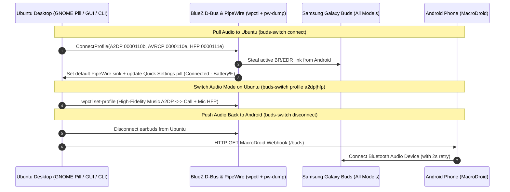

```bash
$ buds-switch toggle
$ buds-settings
```

<h1 align="center">🎧 Samsung Galaxy Buds - Ubuntu & Android Seamless Switcher</h1>
<h3 align="center">One-Click GNOME Quick Settings Toggle, Bidirectional Audio Handoff, A2DP/HFP Switcher & GTK4 Setup GUI for Linux</h3>

<p align="center">
  <a href="https://github.com/pulkitmundra/galaxy-buds-ubuntu">
    
  </a>
</p>

<p align="center">
  
  
  
  
  
</p>

<p align="center">
  <a href="https://github.com/pulkitmundra/galaxy-buds-ubuntu/stargazers"></a>&nbsp;
  <a href="https://extensions.gnome.org/extension/11611/samsung-galaxy-buds-quick-settings-switcher/"></a>&nbsp;
  <a href="https://github.com/pulkitmundra/galaxy-buds-ubuntu/releases"></a>&nbsp;
  <a href="https://github.com/pulkitmundra"></a>&nbsp;
  <a href="https://pulkit-mundra-portfolio.vercel.app"></a>&nbsp;
  <a href="https://buymeacoffee.com/pulkitmundra"></a>&nbsp;
  <a href="https://github.com/sponsors/pulkitmundra"></a>
</p>

<p align="center">
  <a href="#why-this-exists">Why This Exists</a> -
  <a href="#supported-models">Supported Models</a> -
  <a href="#settings-gui">Settings & Setup GUI</a> -
  <a href="#architecture">Architecture</a> -
  <a href="#quick-start">Quick Start</a> -
  <a href="#android-setup">Android Setup</a> -
  <a href="#cli-usage">CLI Usage</a> -
  <a href="#author">Author</a>
</p>

---

<a id="why-this-exists"></a>
## ⚡ The Problem & How This Solves It

Samsung Galaxy Buds only support *Samsung Seamless Switch* between Samsung OneUI devices, and newer models (`Buds3 Pro`, `Buds3`, `Buds2 Pro`) advertise **both** Classic Bluetooth (`BR/EDR`) and Bluetooth Low Energy (`LE Audio`) over the same MAC address. On Ubuntu/Linux (`BlueZ`), this causes major headaches:

1. **LE Audio (`BAP`) Contention**: Standard `bluetoothctl connect` or clicking Connect in GNOME Settings frequently hangs or fails on dual-mode earbuds because BlueZ attempts to negotiate experimental LE Audio (`BAP`) instead of Classic Audio (`A2DP Sink` / `AVRCP` / `HFP`).
2. **Dead Air on Disconnect**: Disconnecting the earbuds from Ubuntu leaves them idle instead of reconnecting them back to your Android phone.
3. **Buried Audio Profile Switching**: Switching between High-Fidelity Stereo Music (`A2DP`) and Call + Microphone (`HFP/HSP`) normally requires digging through GNOME Sound Settings.

| Behavior | Stock Ubuntu Bluetooth | `galaxy-buds-ubuntu` (v1.2.0) |
| :--- | :---: | :---: |
| **1-Click Install from GNOME Extensions Store** | `[ ]` N/A | `[x]` Official on [`extensions.gnome.org`](https://extensions.gnome.org/extension/11611/samsung-galaxy-buds-quick-settings-switcher/) |
| **Steal Audio from Android in 1 Click** | `[ ]` Often fails on LE Audio | `[x]` Connects `BR/EDR` UUIDs (`A2DP`, `AVRCP`, `HFP`) over D-Bus |
| **Universal Samsung Galaxy Buds Support** | `[ ]` Generic Bluetooth menu | `[x]` Auto-detects model name (`Buds3 Pro`, `Buds2 Pro`, `Buds FE`, etc.) |
| **Live Battery % in GNOME Quick Settings** | `[ ]` Hidden in settings | `[x]` Shows `Connected - 85%` right on the Quick Settings pill |
| **1-Click Music (`A2DP`) vs Call (`HFP`) Toggle** | `[ ]` Buried in Sound Settings | `[x]` Built into Quick Settings menu + `buds-switch profile [a2dp\|hfp]` |
| **Auto-Set PipeWire Default Output Sink** | `[ ]` Manual switch needed | `[x]` Automatically routes via `wpctl` |
| **Push Audio Back to Android on Disconnect** | `[ ]` Leaves earbuds idle | `[x]` Triggers MacroDroid webhook for instant phone reconnect |
| **Native GTK4 Settings & Setup Guide GUI** | `[ ]` Manual config files | `[x]` Libadwaita Preferences (`buds-settings`) with 1-click BlueZ scan |

---

<a id="supported-models"></a>
## 🎧 Supported Samsung Galaxy Buds Models

All Samsung Galaxy Buds models implement the same Classic Bluetooth (`BR/EDR`) profile UUIDs (`A2DP Sink 0000110b`, `AVRCP 0000110e`, `HFP 0000111e`) and keep a passive Classic Bluetooth listener active while connected to your phone:

| Samsung Model | 1-Click Pull to Ubuntu | 1-Click Push to Android | Live Battery `%` & `A2DP`/`HFP` Toggle | Notes |
| :--- | :---: | :---: | :---: | :--- |
| **Galaxy Buds3 Pro** | `[x]` | `[x]` | `[x]` | Bypasses `LE Audio (BAP)` contention via explicit `BR/EDR` profile connect |
| **Galaxy Buds3** | `[x]` | `[x]` | `[x]` | Bypasses `LE Audio (BAP)` contention via explicit `BR/EDR` profile connect |
| **Galaxy Buds2 Pro** | `[x]` | `[x]` | `[x]` | Bypasses `LE Audio` contention + full `GalaxyBudsClient` support |
| **Galaxy Buds2** | `[x]` | `[x]` | `[x]` | Instant passive `BR/EDR` takeover + full `GalaxyBudsClient` support |
| **Galaxy Buds Pro** | `[x]` | `[x]` | `[x]` | Instant passive `BR/EDR` takeover + full `GalaxyBudsClient` support |
| **Galaxy Buds FE** | `[x]` | `[x]` | `[x]` | Instant passive `BR/EDR` takeover + full `GalaxyBudsClient` support |
| **Galaxy Buds Live** | `[x]` | `[x]` | `[x]` | Instant passive `BR/EDR` takeover + full `GalaxyBudsClient` support |
| **Galaxy Buds+ / Buds** | `[x]` | `[x]` | `[x]` | Instant passive `BR/EDR` takeover + full `GalaxyBudsClient` support |

---

<a id="settings-gui"></a>
## 🖥️ Native GTK4 / Libadwaita Settings & Android Setup GUI (`prefs.js` / `buds-settings`)

Click **"Settings & Android Setup Guide"** inside the GNOME Quick Settings dropdown menu (or run `buds-settings` / `gnome-extensions prefs galaxy-buds-switcher@pulkitmundra.github.io`) to open the native GTK4 / Libadwaita `Adw.PreferencesWindow` backed by `GSettings` (`org.gnome.shell.extensions.galaxy-buds-switcher`):

1. **Tab 1 - Configuration (`Configuration`):**
   - **Auto-Detect Paired Earbuds (`Scan BlueZ`)**: 1-click asynchronous scan of BlueZ (`org.bluez.Device1`) that automatically detects any paired Samsung Galaxy Buds model and saves its MAC address to `GSettings` (`bud-mac`). You can also leave MAC blank for automatic runtime discovery.
   - **Android Auto-Reconnect Webhook (`MacroDroid`)**: Bind and save your `macrodroid-webhook` base URL directly in `GSettings` (and automatically sync to `~/.config/buds-switch.env` when launched via `buds-settings`).
2. **Tab 2 - Android Setup & Project Links (`Android Setup`):**
   - Step-by-step interactive guide explaining how passive `BR/EDR` audio pull and MacroDroid webhook push work (`buds` trigger + 2-second retry action + Unrestricted battery setting).
   - Quick-launch buttons for the **Official GNOME Extensions Store Page**, **GitHub Repository**, and **Issue Tracker**.

---

<a id="architecture"></a>
## 🧠 Bidirectional Handoff Architecture



---

<a id="quick-start"></a>
## 🚀 Quick Start (Ubuntu 24.04+ / GNOME 45 - 48)

### Option 1: Install from Official GNOME Extensions Store (Recommended)

The GNOME Shell extension is 100% standalone (`Gio.DBus` + `GSettings` + `LibSoup` + `Adw.PreferencesWindow`) and can be installed in one click:

1. **Via Web Browser:** Open [**Samsung Galaxy Buds Quick Settings Switcher on `extensions.gnome.org`**](https://extensions.gnome.org/extension/11611/samsung-galaxy-buds-quick-settings-switcher/) and toggle the switch to **ON**.
2. **Or via Extension Manager App:**
   ```bash
   sudo apt install -y gnome-shell-extension-manager
   ```
   Open **Extension Manager** -> **Browse** -> search for **`Samsung Galaxy Buds Quick Settings Switcher`** -> click **Install**.
3. Open the top-right GNOME **Quick Settings** menu -> expand the **Galaxy Buds** arrow -> click **Settings & Android Setup Guide** -> click **Scan BlueZ** to auto-detect your paired earbuds (or leave MAC blank for automatic discovery).

---

### Option 2: Full Suite Installer (`buds-switch` CLI + `GalaxyBudsClient` + Extension)

If you also want the `buds-switch` terminal CLI (for custom keyboard shortcuts like `Super + B`), `buds-settings` launcher, and automatic download of the portable `GalaxyBudsClient` manager:

#### 1. Install System Prerequisites

```bash
sudo apt update
sudo apt install -y bluez libglib2.0-bin libnotify-bin curl wireplumber pipewire-bin gjs gir1.2-adw-1 gnome-shell-extension-prefs zip
```

<details open>
<summary><b>🛡️ Recommended: Prevent Ubuntu from Auto-Stealing Earbuds on Boot/Resume</b></summary><br>

By default on Ubuntu, `AutoEnable=true` in `/etc/bluetooth/main.conf` causes Ubuntu to power on Bluetooth at boot/resume and automatically steal your earbuds away from your phone. Setting `AutoEnable=false` stops unsolicited auto-stealing while `buds-switch connect` powers on Bluetooth automatically whenever you click Connect:

```bash
sudo sed -i 's/^#*AutoEnable\s*=.*/AutoEnable=false/' /etc/bluetooth/main.conf
sudo systemctl restart bluetooth
```

Pair and trust your Samsung Galaxy Buds once with Ubuntu while they are in pairing mode:
```bash
bluetoothctl
# Inside bluetoothctl:
# power on
# scan on
# pair XX:XX:XX:XX:XX:XX
# trust XX:XX:XX:XX:XX:XX
# connect XX:XX:XX:XX:XX:XX
```

</details>

#### 2. Clone & Run the Automated Installer

```bash
git clone https://github.com/pulkitmundra/galaxy-buds-ubuntu.git ~/Desktop/prsnl/galaxy-buds-ubuntu
cd ~/Desktop/prsnl/galaxy-buds-ubuntu
chmod +x install.sh
./install.sh
```

#### 3. Configure via GUI (`buds-settings`) or `.env`

Launch the native GTK4 Settings & Setup Guide GUI:

```bash
buds-settings
```

Click **"Scan BlueZ"**, paste your optional MacroDroid webhook URL, and it saves directly to `GSettings` and `.env`:

```ini
BUD_MAC="XX:XX:XX:XX:XX:XX"
MACRODROID_WEBHOOK_BASE="https://trigger.macrodroid.com/YOUR-UUID-HERE"
```

<details>
<summary><b>🔍 What <code>./install.sh</code> configures (Click to expand)</b></summary><br>

1. Symlinks `.env` -> `~/.config/buds-switch.env` (`0600` owner-only permissions) and syncs with `GSettings` (`org.gnome.shell.extensions.galaxy-buds-switcher`)
2. Symlinks `buds-switch` -> `~/.local/bin/buds-switch` and `buds-settings` -> `~/.local/bin/buds-settings`
3. Symlinks `earbuds-symbolic.svg` -> `~/.local/share/icons/earbuds-symbolic.svg`
4. Downloads the official portable **GalaxyBudsClient** binary to `~/.local/opt/galaxybudsclient/GalaxyBudsClient` (verified via SHA-256 checksum) and installs `~/.local/share/applications/galaxybudsclient.desktop`
5. Installs and enables the GNOME Shell Quick Settings extension (`galaxy-buds-switcher@pulkitmundra.github.io`) and builds the distributable store package in `dist/galaxy-buds-switcher@pulkitmundra.github.io.shell-extension.zip`.

</details>

---

<a id="android-setup"></a>
## 📱 Android Auto-Reconnect Setup (MacroDroid)

<details open>
<summary><b>Step-by-Step MacroDroid Webhook Configuration (Also available inside <code>buds-settings</code>)</b></summary><br>

To make your Android phone automatically grab the earbuds the instant you click **Disconnect** on Ubuntu:

1. Install **MacroDroid** from the Google Play Store on your Android phone.
2. Create a new Macro named **Connect Buds**:
   - **Trigger**: `Webhook (Url)` -> Set identifier to `buds`
     - Copy the generated base URL (`https://trigger.macrodroid.com/xxxxxxxx-xxxx-xxxx-xxxx-xxxxxxxxxxxx`) into the **Configuration** tab of `buds-settings` (or `MACRODROID_WEBHOOK_BASE` in `.env`, without `/buds` at the end).
   - **Actions**:
     1. `Configure Bluetooth` -> **Connect to Audio Device** -> Select your **Galaxy Buds**
     2. `Wait Before Next Action` -> **2 Seconds**
     3. `Configure Bluetooth` -> **Connect to Audio Device** -> Select your **Galaxy Buds** *(second retry ensures connection if BlueZ takes a moment to release the RFCOMM link)*
3. Save and enable the Macro, and set MacroDroid's battery optimization to **Unrestricted** on Android (`Settings -> Apps -> MacroDroid -> Battery -> Unrestricted`) so webhooks deliver instantaneously while the phone screen is off.

</details>

---

<a id="cli-usage"></a>
## 💻 CLI & Keyboard Shortcuts

| Command | Description |
| :--- | :--- |
| `buds-switch toggle` | Toggle connection between Ubuntu and Android |
| `buds-switch connect` | Pull earbuds from Android to Ubuntu (`A2DP` + `AVRCP` + `HFP`) and set default PipeWire sink |
| `buds-switch disconnect` | Disconnect from Ubuntu and trigger Android MacroDroid webhook |
| `buds-switch profile a2dp` | Switch Ubuntu audio mode to **High-Fidelity Music (`A2DP Sink`)** |
| `buds-switch profile hfp` | Switch Ubuntu audio mode to **Call + Microphone (`HFP/HSP`)** |
| `buds-switch battery` | Print current earbuds battery percentage (e.g. `85%`) |
| `buds-switch settings` | Open the GTK4 / Libadwaita Settings & Android Setup Guide GUI (`buds-settings`) |
| `buds-switch status` | Prints `connected` or `disconnected` |

> [!TIP]
> You can bind `buds-switch toggle` to a global hotkey (e.g., `Super + B`) in **Ubuntu Settings -> Keyboard -> Custom Shortcuts** for instant keyboard switching!

---

<details>
<summary><b>📂 Repository Structure (Click to expand)</b></summary><br>

```text
galaxy-buds-ubuntu/
├── extension.js                # Standalone GNOME Shell 45-48 extension entrypoint
├── budsQuickToggle.js          # Quick Settings indicator, async BlueZ D-Bus, live battery %, A2DP/HFP & menu toggle
├── prefs.js                    # GTK4 / Libadwaita ExtensionPreferences window (Configuration & Android Setup)
├── metadata.json               # GNOME Extensions Store metadata (galaxy-buds-switcher@pulkitmundra.github.io)
├── earbuds-symbolic.svg        # Bundled symbolic icon for GNOME Shell & notifications
├── schemas/
│   └── org.gnome.shell.extensions.galaxy-buds-switcher.gschema.xml # GSettings schema (bud-mac & macrodroid-webhook)
├── buds-switch                 # CLI engine (connect | disconnect | toggle | profile | battery | settings | status)
├── buds-settings               # CLI launcher for GNOME Extension Preferences with .env <-> GSettings sync
├── galaxybudsclient.desktop    # Desktop launcher template for GalaxyBudsClient GUI
├── install.sh                  # Automated setup & store bundle packaging script
├── dist/                       # Built GNOME Extensions Store package (.shell-extension.zip)
├── CHANGELOG.md                # Release history
├── LICENSE                     # MIT License
├── .env.example                # Template for your Bluetooth MAC & MacroDroid webhook
└── .gitignore                  # Ignores .env so personal MAC/webhook are never committed
```

</details>

---

<a id="faq"></a>
## ❓ Frequently Asked Questions (Samsung Galaxy Buds on Ubuntu & Linux)

### How do I get Multipoint Bluetooth switching for Samsung Galaxy Buds3 Pro, Buds2 Pro, or Buds FE on Ubuntu/Linux?
Samsung Galaxy Buds only support "Seamless Earbud Connection" inside Samsung's proprietary One UI ecosystem, not standard Bluetooth Multipoint with Linux PCs. **Galaxy Buds Ubuntu Switcher** bridges that gap on GNOME 45-48 by exploiting Galaxy Buds' passive Bluetooth takeover behavior (`bluez` + `PipeWire`) together with an optional lightweight Android MacroDroid UDP/Webhook bridge, giving you one-click switching in the GNOME top-right Quick Settings menu and automatic handoff when your Android phone rings.

### How do I check Samsung Galaxy Buds battery percentage and switch between A2DP and HFP on Ubuntu?
Once installed (`./install.sh`), the GNOME Quick Settings pill displays live earbuds battery percentage (`UPower` / `BlueZ Battery1`) and expands into a submenu to switch between **High-Fidelity Music (`A2DP Sink`)** and **Call + Microphone (`HFP/HSP`)** with a single click or via `buds-switch profile a2dp|hfp`.

---

<a id="more-projects"></a>
## 🔗 More Linux & Ubuntu Desktop Apps by Pulkit Mundra

| Project | Description | Links |
| :--- | :--- | :--- |
| **[Crunchyroll Ubuntu Desktop](https://github.com/pulkitmundra/crunchyroll-ubuntu-desktop)** | Unofficial Linux Desktop & HTPC client for Crunchyroll with Widevine DRM, Custom Lists, Auto-Skip HUD, In-Player Quality Selector, Sleep Timer & Auto-PiP Mini-Player | [GitHub](https://github.com/pulkitmundra/crunchyroll-ubuntu-desktop) · [Snap Store](https://snapcraft.io/crunchyroll-ubuntu-desktop) |
| **[NVR Command Center](https://github.com/pulkitmundra/nvr-command-center)** | Ultra-low-latency GPU RTSP IP Camera, CCTV, NVR/DVR/XVR & Cloud P2P Surveillance Viewer for Linux/Ubuntu in Native Rust (Dahua SmartPSS/DMSS, CP Plus KVMS/gCMOB, Hikvision iVMS-4200, Amcrest, ONVIF) | [GitHub](https://github.com/pulkitmundra/nvr-command-center) · [Snap Store](https://snapcraft.io/nvr-command-center) |

---

<a id="author"></a>
## 👨🏻‍💻 Author, Support & Contact

Built and maintained by **Pulkit Mundra** (Senior Software Developer - SDE-3). Issues, feature requests, and pull requests are welcome!

If this tool saved you from Bluetooth pairing headaches on Ubuntu, consider buying me a coffee or sponsoring the project:

<p align="left">
  <a href="https://buymeacoffee.com/pulkitmundra">
    
  </a>
  <a href="https://github.com/sponsors/pulkitmundra">
    
  </a>
  <a href="https://pulkit-mundra-portfolio.vercel.app">
    
  </a>
  <a href="https://github.com/pulkitmundra">
    
  </a>
  <a href="https://www.linkedin.com/in/pulkit-mundra/">
    
  </a>
  <a href="mailto:pmundra8@gmail.com">
    
  </a>
</p>

## 📜 License

MIT License (see [`LICENSE`](LICENSE)).

---

<p align="center">
  <b>If this tool saved you from Bluetooth pairing headaches on Ubuntu, please consider giving the repo a ⭐ or <a href="https://buymeacoffee.com/pulkitmundra">buying me a coffee ☕</a>!</b>
</p>
